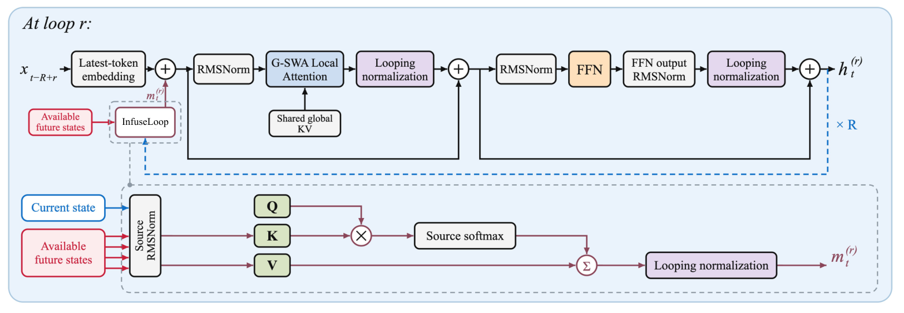
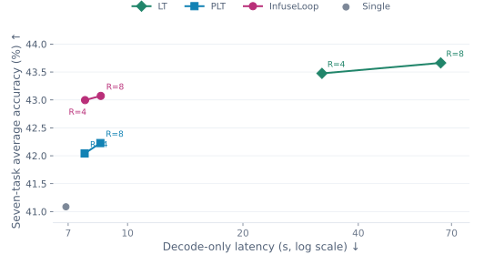

<div align="center">

# InfuseLoop

**Cross-Trajectory Latent Injection for Scalable Parallel Looped Transformers**

Go deeper. Stay fast.

[](https://thuecstasy.github.io/InfuseLoop/)
[](https://huggingface.co/collections/thuEcstasy1/infuseloop-6af0ae0ca484a3099351831f)
[](LICENSE)

[Quick start](#quick-start) · [Models](#models) · [Method](#how-it-works) · [Results](#results) · [Training](#training-and-validation)

</div>

InfuseLoop makes completed cross-trajectory representations available to recurrent computation through lightweight attention residuals. It improves depth scaling while preserving token-parallel training and concurrent loop execution.

<p align="center"></p>

## Results

**At eight loops, InfuseLoop improves the seven-task average by 0.84 percentage points over PLT with about 0.3% additional decoding latency.** It reduces perplexity by 3.4–17.1% across WikiText-2 and LAMBADA. Serial LT retains higher absolute quality, with substantially longer decoding latency.

<p align="center"></p>

Latency uses one NVIDIA GB200 at batch size 32, with 2,048-token prompts and outputs. The median of three runs covers the 2,047 cached decoding steps after prefill. See [measurements](results/decode-latency-gb200-b32.csv) and [benchmark notes](docs/benchmarks.md).

## Models

| Model | Loops | Parameters | Training tokens | WikiText-2 PPL ↓ | LAMBADA PPL ↓ | Seven-task avg. (%) ↑ |
|:---|---:|---:|---:|---:|---:|---:|
| [InfuseLoop-4](https://huggingface.co/thuEcstasy1/InfuseLoop-4) | 4 | 596,139,465 | 6B | 35.70 | 45.08 | 43.00 |
| [InfuseLoop-8](https://huggingface.co/thuEcstasy1/InfuseLoop-8) | 8 | 596,143,587 | 6B | **35.55** | **42.04** | **43.07** |

Both are **base language models pretrained from a common random initialization**. They use the Qwen3-0.6B backbone configuration and tokenizer, rather than pretrained Qwen3 weights. Use natural text prefixes without a chat template. Released weights retain FP32 precision.

## Quick start

```bash
git clone https://github.com/thuEcstasy/InfuseLoop.git
cd InfuseLoop
pip install -e .
python scripts/generate.py --model thuEcstasy1/InfuseLoop-8 \
  --prompt "The scientist repeated the experiment and found that" --max-new-tokens 32
```

```python
from transformers import AutoTokenizer
from infuseloop import InfuseLoop

model_id = "thuEcstasy1/InfuseLoop-8"
tokenizer = AutoTokenizer.from_pretrained(model_id)
model = InfuseLoop.from_pretrained(model_id, device="cuda")
inputs = tokenizer(
    "The scientist repeated the experiment and found that",
    return_tensors="pt", add_special_tokens=False,
).input_ids.cuda()
outputs = model.generate(inputs, max_new_tokens=32, eos_token_id=tokenizer.eos_token_id)
print(tokenizer.decode(outputs[0, inputs.shape[1]:], skip_special_tokens=True))
```

`InfuseLoop` is a custom PyTorch class. The reference `generate` method supports greedy continuation with equally sized, unpadded prompts. Lower-level `prefill` and `decode` APIs support explicit cache management, validity masks, document transitions, and cache reordering. The models are not registered with Transformers `AutoModelForCausalLM`.

<details>
<summary>Compatibility with the previous project name</summary>

The project was previously named ForesightLoop. The legacy `from foresightloop import ForesightLoop` import remains available, and the serialized checkpoint format is retained for compatibility. Model weights and numerical computations are unchanged by the rename.

</details>

## How it works

- **Reuse fresh representations.** Each loop aggregates selected outputs from the immediately preceding execution cycle, including its in-trajectory base state and available shallower-loop states from later prediction trajectories.
- **Preserve parallelism.** All sources are already computed and causal. Shallower-loop source selection supports token-parallel training, while inference executes active loops concurrently.
- **Keep retained state compact.** Auxiliary loop-output storage is O(Rd). G-SWA shares first-loop global KV and keeps a private 64-token local window for each later loop.

The shared backbone has 28 layers, hidden dimension 1,024, FFN dimension 3,072, 16 query heads, eight KV heads, and head dimension 128. A later prediction trajectory does not provide access to future input tokens.

## Training and validation

Main models use FineWeb-Edu with a 6B-token budget; component ablations use 1B tokens. Increasing loop count adds training computation under the fixed-data comparison. See [training settings](configs/training.json).

```bash
# Pretokenized little-endian uint32 IDs, rows of sequence_length + 1.
torchrun --standalone --nproc_per_node=4 scripts/train.py \
  --tokens /path/to/train.u32 --loops 4 --sequence-length 1024 \
  --global-batch-size 128 --micro-batch-size 1 --steps 45777 --output checkpoints/r4
```

Training processes loops in order and positions in parallel. `Model.forward(tokens, targets)` returns summed next-token cross-entropy; the example script normalizes by target count and supports PyTorch DDP. Corpus packing order and cluster orchestration are outside this release.

```bash
pip install -e '.[test]'
OMP_NUM_THREADS=1 pytest -q
```

The tests check parallel execution against incremental decoding and an independent token-by-token oracle, including causality, boundaries, padding, gradients, and checkpoint round trips. Export validation compares every weight tensor with the training checkpoint; released-model checks compare full-size FP32 logits with the frozen evaluation graph.

**This repository provides a readable eager PyTorch reference.** The paper's optimized latency measurements use a separate CUDA Graph implementation with vLLM FA4 and custom Triton kernels. They are not serving-scheduler measurements, and the eager reference does not reproduce those timings.

## Scope and license

Evidence covers approximately 0.6B dense models and measured depths of four and eight loops. Larger models, MoE, and deeper recurrence remain open. These checkpoints are not instruction-tuned and can generate inaccurate or repetitive text.

Code and model weights are released under [Apache-2.0](LICENSE); see [NOTICE](NOTICE) for attribution. No training corpus, optimizer states, private launchers, or cluster credentials are distributed. The tokenizer and dependencies retain their respective licenses.
